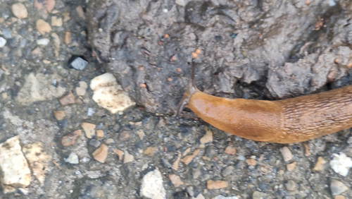
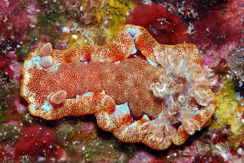

# slugid

Slug species classifier: BioCLIP ViT-B/16 fine-tuned on iNaturalist open data, with species/genus/family heads and an optional location prior. 223 classes (222 species plus "other").

**Live demo:** https://blmjn7nia4daa3ksswqhfl6nce0vuoqq.lambda-url.us-west-2.on.aws/ (upload a photo; the first request after a deploy takes about 75 s while the model loads)

## Accuracy

Splits are grouped by observer, so no photographer appears in more than one split. Checkpoint selection used val, so test is the number to quote.

| | Val (45,335 photos) | Test (47,139 photos) |
|:--|:-:|:-:|
| Top-1 | 94.2% | 93.2% |
| Top-5 | 99.1% | 98.7% |
| Macro top-1 (balanced accuracy) | 94.1% | 93.2% |
| Macro F1 | 94.1% | 93.1% |
| Genus / family top-1 | 97.1 / 97.7% | 96.4 / 96.9% |
| Top-1 with location prior | 96.6% | 95.9% |
| Top-1, max 50 photos per observer | 91.9% | 92.0% |

- A few prolific observers inflate the full-set numbers: ten observers supply about 40% of val and test photos and are easier than average. Capping photos per observer gives about 92%, the better estimate for a new user.
- About half of the errors are sibling species in the same genus (for example *Ariolimax californicus* vs *dolichophallus*). The median species has 96–97% recall, but 54 of 223 species are below 90% on test.
- Softmax scores are underconfident (ECE about 0.09), so treat them as a ranking, not a probability.

| | |
|:-:|:-:|
|  |  |
| **Arion fuscus** 0.79 · Arion subfuscus 0.10 | **Hexabranchus lacer** 0.90 |

## Setup

```bash
python3.11 -m venv .venv && source .venv/bin/activate
pip install -e ".[dev,train]"
pytest -q
```

## Pipeline

```bash
python -m slugid.data.build_manifest --config configs/data.yaml --metadata-dir <inat-metadata> --out data/manifest.parquet
python -m slugid.data.download --manifest data/manifest.parquet --image-dir data/images --out data/manifest_clean.parquet
python -m slugid.train --config configs/train_bioclip.yaml --manifest data/manifest_clean.parquet --image-dir data/images --out data/runs/bioclip
python -m slugid.geo --manifest data/manifest_clean.parquet --classes-from data/runs/bioclip/best.pt --val-logits data/runs/bioclip/val_logits.pt --out data/runs/geo
```

## Deploy (AWS Lambda)

GitHub Actions builds the image, smoke-tests it, pushes it to ECR and deploys `infra/app.yaml`. Each prediction is logged to S3 and queryable in Athena (workgroup `slugid`, with saved queries).

```bash
aws cloudformation deploy --stack-name slugid-bootstrap --template-file infra/bootstrap.yaml \
  --capabilities CAPABILITY_IAM --parameter-overrides BudgetEmail=<email>
python -m slugid.export --checkpoint data/runs/bioclip_e12/best.pt --manifest data/manifest_clean.parquet --out data/export
aws s3 cp data/export/ s3://slugid-models-<account>-<region>/models/v2/ --recursive
```

Set repo variables `AWS_REGION` and `AWS_ROLE_ARN` (the bootstrap stack's `DeployRoleArn` output), then run the Deploy workflow. The model version it ships is `MODEL_VERSION` in `.github/workflows/deploy.yml`.

```bash
curl -F file=@slug.jpg <function-url>/v1/predict
```
